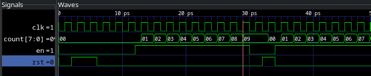
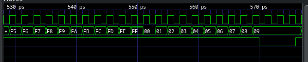

## Counter Module (`counter.sv`)

```systemverilog
module counter #(
  parameter WIDTH = 8
)(
  // interface signals
  input logic clk, //clock
  input logic rst, //reset
  input logic en, //counter enable
  output logic [WIDTH-1:0] count
);

always_ff @(posedge clk, posedge rst) begin
	if (rst) count <= {WIDTH{1'b0}};
	else count <= count + {{WIDTH-1{1'b0}}, en};
end

endmodule
```

## Counter Testbench (`counter_tb.cpp`)

```cpp
#include "Vcounter.h"
#include "verilated.h"
#include "verilated_vcd_c.h"

int main(int argc, char **argv, char **env) {
	int i;
	int pause_cycles = 0; // Track how many cycles we've been paused

	Verilated::commandArgs(argc, argv);
	Vcounter* top = new Vcounter;
	Verilated::traceEverOn(true);
	VerilatedVcdC* tfp = new VerilatedVcdC;
	top->trace(tfp, 99);
	tfp->open("counter.vcd");

	top->clk = 0;
	top->rst = 0;
	top->en = 0;

	for (i = 0; i < 300; i++) {
		// 1. ALWAYS dump time, toggle the clock, and evaluate the model
		for (int clk = 0; clk < 2; clk++) {
			tfp->dump(2*i + clk);
			top->clk = !top->clk;
			top->eval();
		}

		// 2. Change the reset stimulus so it doesn't interrupt us at i==15
		top->rst = (i < 2) | (i == 15);

		// 3. Pause logic using the hardware 'en' signal
		if (top->count == 0x9) {
			if (pause_cycles < 3) {
				top->en = 0;       // Disable counting
				pause_cycles++;    // Count the pause cycles
			} else {
				top->en = 1;       // Resume counting once 3 cycles pass
			}
		} else {
			top->en = (i > 4);     // Normal enable condition
			pause_cycles = 0;      // Reset the pause tracker for the next time it hits 9
		}

		if (Verilated::gotFinish()) exit(0);
	}
	tfp->close();
	exit(0);
}
```

## Simulation Commands

```bash
verilator -Wall --cc --trace counter.sv --exe counter_tb.cpp
make -j -C obj_dir/ -f Vcounter.mk Vcounter
./obj_dir/Vcounter
```





