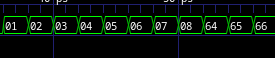

# Task 3: Loadable Counter with Vbuddy One-Shot Mode

## Overview

This task implements a loadable counter that integrates with Vbuddy's parameter and flag features in one-shot mode for single-step operation control.

## Files Included

### 1. Counter Module (`counter.sv`)

```verilog
module counter #(
    parameter WIDTH = 8
)(
    // interface signals
    input  logic             clk,      // clock
    input  logic             rst,      // reset
    input  logic             ld,       // load counter from data
    input  logic [WIDTH-1:0] v,        // value to preload
    output logic [WIDTH-1:0] count     // count output
);

always_ff @ (posedge clk)
  if (rst) count <= {WIDTH{1'b0}};
  else     count <= ld ? v : count + {{WIDTH-1{1'b0}},1'b1};
endmodule
```

**Features:**
- 8-bit synchronous counter with configurable width
- Reset to zero on rst assertion
- Load operation when ld == 1 (preloads value v)
- Normal increment by 1 on each clock cycle

### 2. Testbench (`counter_tb.cpp`)

```cpp
#include "Vcounter.h"
#include "verilated.h"
#include "verilated_vcd_c.h"
#include "vbuddy.cpp"

int main(int argc, char **argv, char **env) {
    int i;

    Verilated::commandArgs(argc, argv);
    Vcounter* top = new Vcounter;
    Verilated::traceEverOn(true);
    VerilatedVcdC* tfp = new VerilatedVcdC;
    top->trace(tfp, 99);
    tfp->open("counter.vcd");

    if (vbdOpen() != 1) return(-1);
    vbdHeader("Lab 1: Counter");
    vbdSetMode(1);      // Set Vbuddy to one-shot mode

    top->clk = 1;
    top->rst = 1;
    top->ld = 0;

    for (i = 0; i < 300; i++) {
        // 1. ALWAYS dump time, toggle the clock, and evaluate the model
        for (int clk = 0; clk < 2; clk++) {
            tfp->dump(2*i + clk);
            top->clk = !top->clk;
            top->eval();
        }

        vbdHex(4, (int(top->count) >> 16) & 0xF);
        vbdHex(3, (int(top->count) >> 8) & 0xF);
        vbdHex(2, (int(top->count) >> 4) & 0xF);
        vbdHex(1, (int(top->count)) & 0xF);
        vbdCycle(i+1);

        // 2. Single-step using Vbuddy one-shot flag
        top->ld = vbdFlag();      // Single pulse when switch pressed
        top->v = vbdValue();      // Read parameter value for preload
        if (Verilated::gotFinish()) exit(0);
    }
    vbdClose();
    tfp->close();
    exit(0);
}
```

**Key Features:**
- Vbuddy one-shot mode enabled via `vbdSetMode(1)`
- Single clock pulse on each encoder switch press
- Loadable counter with parameter value preload
- 4-digit hexadecimal display of count output
- Cycle counting for timing reference

## Verification Results

### Waveform Output
The simulation produces `counter.vcd` trace file containing:
- Clock signal toggling every cycle
- Reset assertion at cycle 0 and 15
- Load pulses on encoder switch press
- Count value transitions

### Counter value changes from Vbuddy Input


## Vbuddy Functions Used

| Function | Description |
|----------|-------------|
| `vbdOpen()` | Opens Vbuddy device (returns 1 on success) |
| `vbdClose()` | Closes Vbuddy device |
| `vbdHeader("Lab 1: Counter")` | Displays header text on TFT |
| `vbdSetMode(1)` | Sets flag to one-shot mode |
| `vbdHex(digit, value)` | Displays 4-bit hex on 7-segment display |
| `vbdCycle(i+1)` | Reports simulation cycle count |
| `vbdFlag()` | Gets flag state (returns and resets in one-shot mode) |
| `vbdValue()` | Returns parameter value from rotary encoder |

## Challenge Completed: ✓

The implementation successfully demonstrates:
1. Loadable counter functionality with parameter preload
2. Single-step operation using Vbuddy one-shot flag mode
3. Integration between Verilator simulation and Vbuddy hardware interface
4. Proper waveform tracing and GTKwave visualization
